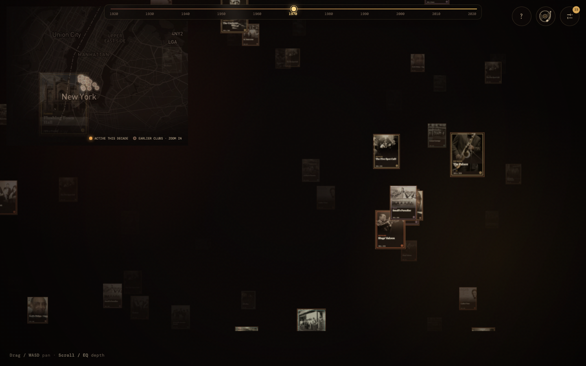

# NYC Jazz Visualiser

> An interactive, infinite 3D visual archive and spatial cartography of over a century of New York City's jazz ecosystem—from 1920s Harlem speakeasies to modern outer-borough lofts.

<p align="center">
  <a href="https://nycjazz.ivanchiew.com" target="_blank" rel="noopener noreferrer">
    
  </a>
</p>

<p align="center">
  <a href="https://nycjazz.ivanchiew.com" target="_blank" rel="noopener noreferrer">
    
  </a>
</p>

---

## Motivation & Story Behind the Project

This project was born out of my personal love for music—especially jazz—and a memorable school trip to New York City.

During my trip, wandering through historical venues and experiencing live jazz events across Manhattan and Brooklyn revealed to me just how deeply intertwined the music is with the geography and socioeconomic history of the city. Visiting the interactive music exhibit at the **Museum of the City of New York (MCNY)** left a lasting impression on me: seeing how multimedia, archival storytelling, and spatial geography could come together to make cultural history feel alive and tactile.

I built this visualiser to capture that experience:
- **Spatial Migration**: How jazz in NYC was never static in one neighbourhood—it evolved from Harlem during Prohibition and the Renaissance, to the fever pitch of 52nd Street swing, into Greenwich Village basements and Lower East Side lofts, and out to modern community hubs in Brooklyn, Queens, and the Bronx.
- **Urban & Economic Pressures**: How changing urban realities—from historical cabarets and police licensing to rising residential rents and redevelopment—continually displaced and reshaped where artists could play.

---

## Key Features

### 1. Infinite 3D Archival Canvas & Decade Transitions
- **Immersive 3D Space**: Built on WebGL / Three.js, archival club cards and photography drift through coordinate space. Card slots use a fixed venue catalog so filtering never assigns a surviving club to another club’s position.
- **Fluid Multi-Modal Navigation**: Navigate using keyboard controls (**WASD** to pan up/down/left/right, **E/Q** to move through depth) or natural mouse gestures (click & drag to pan, wheel/pinch to travel through depth).
- **Ash-Erosion Decade Interlude**: Selecting a decade opens its story; the **Explore** button plays the transition from the preceding decade into the decade just read (e.g., `1980 → 1990`), dissolving closing cards into texture-matched ash while keeping surviving cards in place and revealing new rooms.

### 2. Synchronized Cartography & Rent Economics
- **Interactive 5-Borough Map**: Powered by Mapbox GL JS, visualising 78 researched historical and contemporary venues across Manhattan, Brooklyn, Queens, and the Bronx.
- **Historical Census Rent Layer**: Visualises U.S. Census median contract rent data from IPUMS NHGIS across census tracts, normalised to constant 2020 dollars via annual CPI-U.

### 3. Synchronized Vinyl Soundtrack with Physics & Equal Loudness
- **Authentic Decade Soundtracks**: Each era features a curated signature track—from 1920s King Oliver to 1950s Miles Davis, 1970s loft fusion, and modern revivals.
- **Balanced Loudness Mastering**: Track volumes are normalised using ITU-R BS.1770 / EBU R128 (-19.7 LUFS baseline) with custom Web Audio API gain adjustment to eliminate jarring volume spikes across recordings.
- **Realistic Vinyl Spin-Down**: Turntable button incorporates realistic deceleration physics and tonearm mechanics when muting or unmuting.

### 4. Guided Scrollytelling Stories (1920s–2020s)
- **11 Curated Eras**: Traverse from the 1920s Harlem Renaissance to the 2020s modern scene.
- **Camera-Driven Chapters**: Each decade features four-beat narrative chapters that guide the map camera through representative clubs before transitioning into the filtered canvas.

---

## Quick Start (Run Locally)

Prerequisites: Node 20.20+ and npm 10+.

```bash
# Install dependencies
npm ci

# Configure environment variables
cp .env.example .env

# Run local development server
npm run dev
```

> **Note**: Add a Mapbox access token as `VITE_MAPBOX_TOKEN` in your `.env` to enable the interactive map tiles. If omitted, the app gracefully falls back to an accessible token-free mode and the DOM club browser.

### Quality Checks & Testing

```bash
# Run unit and integration tests
npm test

# Run ESLint
npm run lint

# Compile and verify production build
npm run build

# Run Playwright browser automation tests
npm run test:browser
```

Development and production builds use the generated rent snapshots in `public/data/`; they do not require raw census shapefiles (`scripts/check_rent_data.js` validates those snapshots during `predev` and `prebuild`). Keep `nyc_rent_history.geojson`, all five `nyc_rent_1980.geojson` through `nyc_rent_2020.geojson` snapshots, and `rent_coverage.json` in Git together when updating the rent pipeline.

To regenerate the snapshots, run `npm run build:data`. This requires the preserved NHGIS CSV inputs and 2010/2020 boundaries, plus these optional local boundary files (the two folders are ignored by Git):

- `src/data/nyct1990/tr36_d90.shp` and `tr36_d90.dbf`
- `src/data/nyct2000/tl_2010_36_tract00.shp` and `tl_2010_36_tract00.dbf`

---

## Architecture & Codebase

- `src/infinite-canvas/`: WebGL canvas engine with chunk-streaming, depth attenuation, and multi-input navigation.
- `src/components/DecadeTransition.tsx`, `src/infinite-canvas/ash-material.ts`, and `src/gallery/decade-transition.ts`: Seeded noise dissolve and texture-coloured dust for closing cards alongside synchronised map-marker transitions (using short opacity changes under reduced motion).
- `src/components/CentralMap.tsx` & `src/hooks/useMapbox.ts`: Synchronized Mapbox choropleth rent shading and venue marker layers.
- `src/components/DecadeStory.tsx` & `src/data/decadeStories.ts`: GSAP ScrollTrigger-driven decade scrollytelling beats with choreographed map camera targets.
- `src/data/venues.ts`: Sourced geographic coordinates, operational years, neighbourhood scenes, and historical closure records for 78 NYC jazz venues.
- `src/data/clubProfiles.ts`: Comprehensive venue cards and archival research tiers.
- `src/data/decadeSoundtracks.ts` & `src/hooks/useGallerySoundtrack.ts`: Curated decade audio tracks with Web Audio gain calibration and spin-down physics.
- `src/gallery/model.ts`: Decade boundaries, lifecycle filtering (`active`, `closed`, `future`), and scene taxonomies.
- `scripts/process_census_data.js` & `scripts/check_rent_data.js`: IPUMS NHGIS census data processing and snapshot verification scripts.

---

## Historical Data & Sourcing Boundaries

- **Residential Rent vs Commercial Rent**: Residential rent shading uses median contract rent from IPUMS NHGIS, normalised to constant 2020 dollars with annual CPI-U. It indicates surrounding neighbourhood pressure, not commercial venue leases or proof of why a club closed.
- **Census Boundaries & Coverage**: Rent snapshots use 1990, 2000, 2010, and 2020 tract boundaries for the corresponding years. **1980 remains approximate:** its values are matched by tract ID to 1990 boundaries without a validated geographic conversion, so snapshots should not be subtracted across decades at tract level. `public/data/rent_coverage.json` tracks unique source/matched tracts and extra polygon parts.
- **Top-Coded Sentinels & ACS Periods**: Raw rent values are preserved as `rent_raw`. Exact upper-interval sentinel codes (`501`, `1001`, `2001`, `2001`, and `3501`) are normalised to lower bounds and shown with `+`. The 2010 and 2020 snapshots use 2006–2010 and 2016–2020 ACS five-year estimates, labelled explicitly in tract tooltips.
- **Pre-1980 Housing Context**: The comparable census tract series begins in 1980; earlier housing pressures and discrimination are conveyed through cited historical narration.
- **Venue Closure Records**: Venue histories and closure descriptions document researched historical records and preserve source citations.
- **Listening Selections**: Track selections distinguish between recordings captured live at a venue, documented performer relationships, and era-representative listening pieces.

---

## Credits & Attributions

- **Infinite Canvas Engine**: Adapted from [edoardolunardi/infinite-canvas](https://github.com/edoardolunardi/infinite-canvas) (MIT License, preserved in `THIRD_PARTY_NOTICES/Codrops-Infinite-Canvas-LICENSE.txt`).
- **Tonearm & Turntable Geometry**: Adapted from [Codrops RecordPlayer](https://github.com/codrops/RecordPlayer) (MIT License, preserved in `THIRD_PARTY_NOTICES/Codrops-RecordPlayer-NOTICE.txt`).
- **Census & Demographic Data**: U.S. Census Bureau data retrieved via [IPUMS NHGIS](https://www.nhgis.org/).
- **Archival Imagery & Music**: Sourced from public domain archives, Library of Congress, and historical collections.

---

## Tech Stack

- **Frontend**: React 19, TypeScript, Vite
- **3D Graphics**: Three.js, React Three Fiber (R3F), Drei
- **Mapping & GIS**: Mapbox GL JS, GeoJSON
- **Animation & Audio**: GSAP (ScrollTrigger), Web Audio API
- **Testing**: Node Test Runner, Playwright
